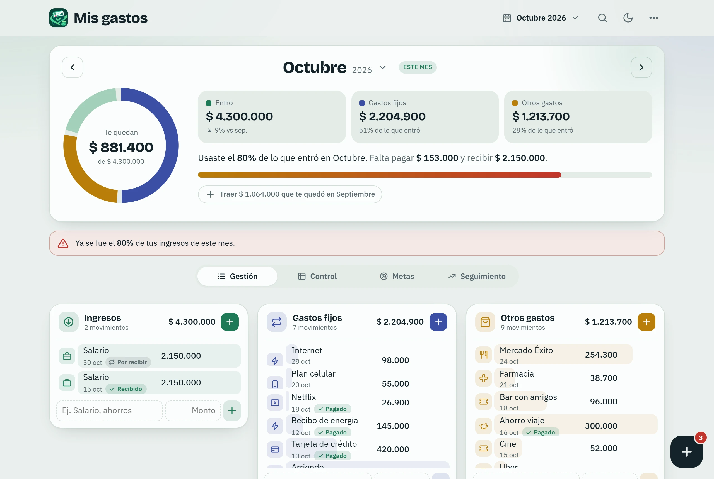
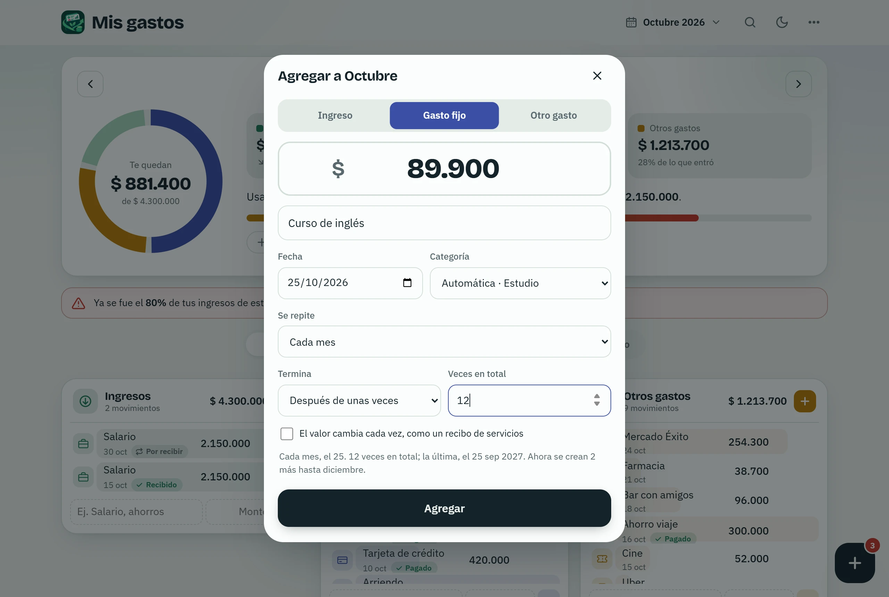
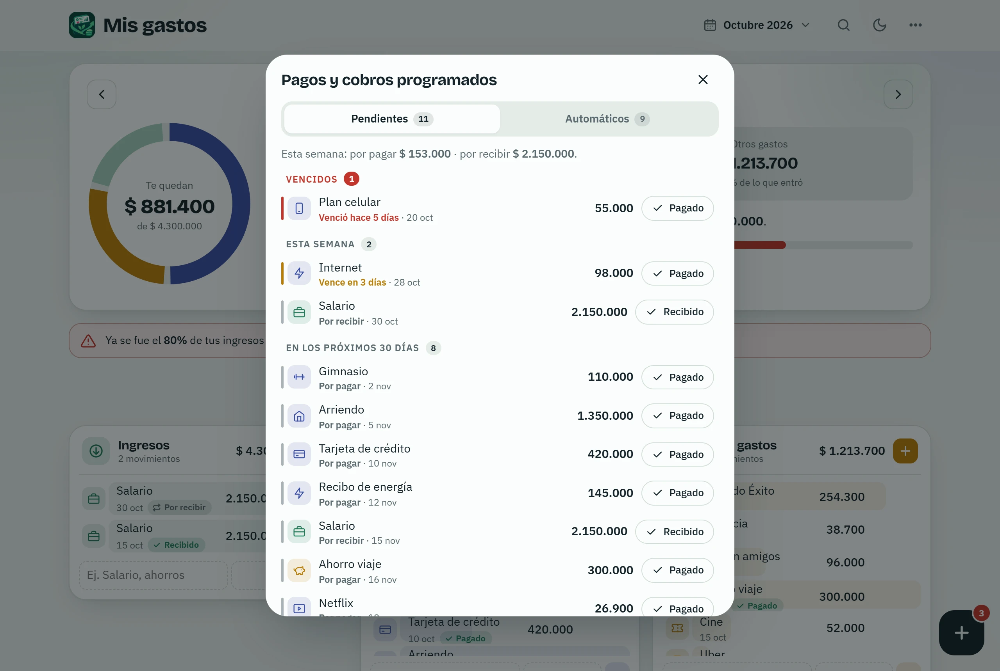
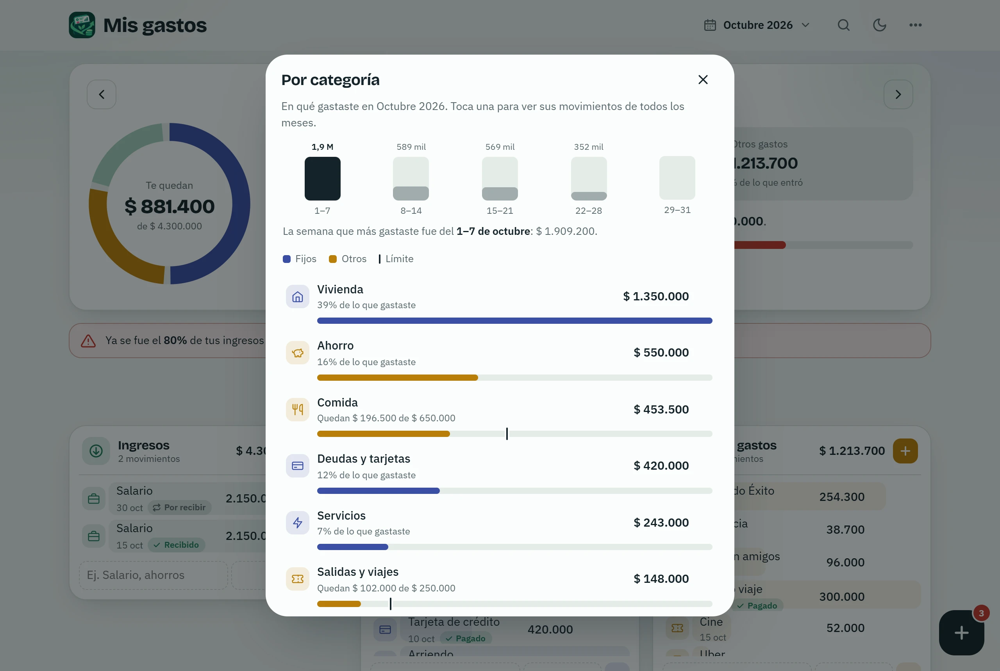
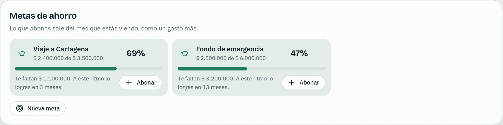
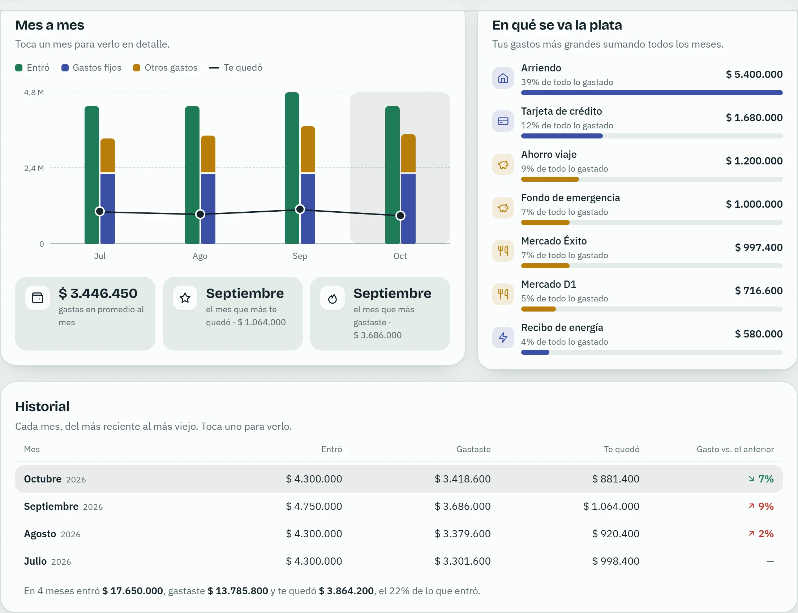
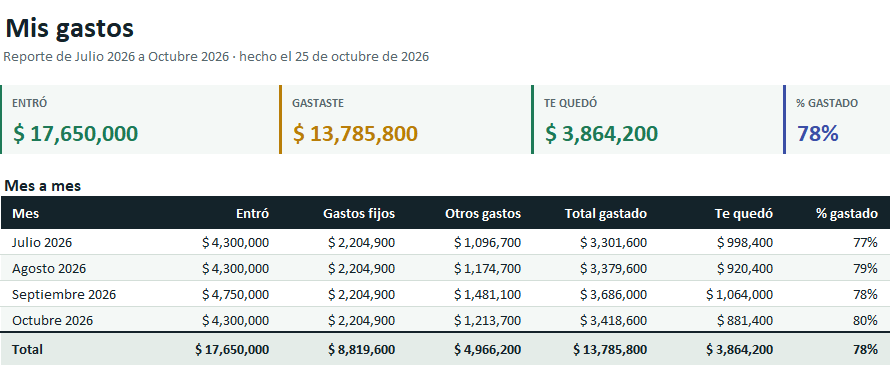
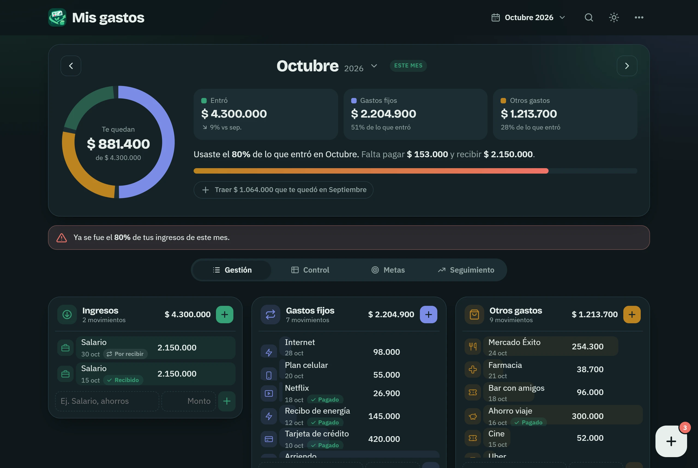
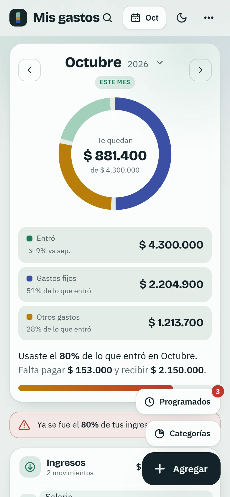
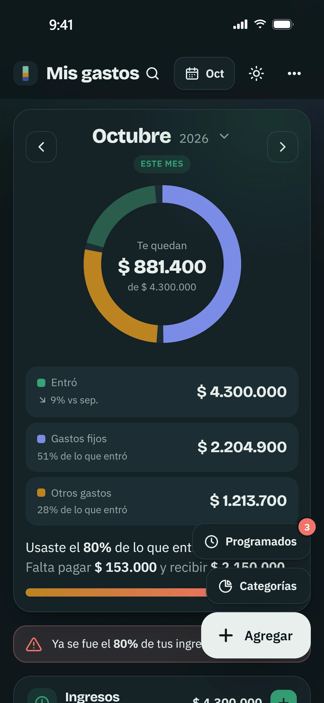

# Mis gastos

Lleva tus ingresos y gastos mes a mes, sin hojas de cálculo y sin crear cuentas. Anotas lo que entra y lo que sale, y la app te dice cuánto te queda, en qué se te va la plata y qué pagos vienen.

## Descargar

**[Descargar Mis gastos para Windows](https://github.com/S3b4sst14n/mis-gastos-descargas/releases/latest)**: en la página que abre, toca el archivo `Mis-gastos-Setup-….exe`.

Funciona en Windows 10 y Windows 11. El instalador pesa unos 3 MB.

### Cómo instalarla

1. Abre el archivo que descargaste.
2. Si Windows muestra **"Windows protegió tu PC"**, toca **Más información** y luego **Ejecutar de todas formas**. Ese aviso sale con los programas que todavía no descarga mucha gente; no quiere decir que tenga algo malo.
3. Sigue los pasos del instalador. Al terminar, la app queda en el menú Inicio como **Mis gastos**.

La app abre vacía, lista para que anotes tus cosas.

## Qué hace

### Tu mes de un vistazo

Arriba ves cuánto entró, cuánto se fue en gastos fijos y en otros gastos, y cuánto te queda. Los movimientos se separan en tres listas: **Ingresos**, **Gastos fijos** y **Otros gastos**. Si ya gastaste buena parte de lo que entró, la app te avisa.

Con las flechas (o tocando el nombre del mes) vas a cualquier mes. Un mes nuevo te ofrece traer los gastos fijos e ingresos del anterior, para no escribirlos otra vez.

### Agregar en segundos

Toca **Agregar**, escribe el monto y en qué fue. La categoría sale sola del concepto ("Almuerzo" queda en Comida, "Arriendo" en Vivienda) y abajo aparecen los conceptos que más usas, con su último monto, para agregarlos con un toque.

### Pagos y cobros que se repiten

Si un movimiento se repite (el arriendo, el salario cada quincena, Netflix, la cuota de la tarjeta), elige **Se repite** al agregarlo: cada semana, quincena, mes, 2, 3 o 6 meses, o cada año. La app crea sola los del resto del año, y puedes decir hasta cuándo: nunca, hasta una fecha o un número de veces.

El botón **Programados** te muestra lo que está por pagar y por recibir. Un número en el botón dice cuántos vencen esta semana, en rojo si ya se venció alguno. Desde ahí marcas cada uno como pagado o recibido.

### En qué se va la plata

El botón **Categorías** muestra cuánto gastaste en cada categoría este mes y cuál fue la semana en que más gastaste. A cada categoría le puedes poner un **límite** al mes: la barra muestra cuánto te queda y la app te avisa si te pasas.

### Metas de ahorro

Crea una meta (un viaje, un fondo de emergencia) con cuánto quieres reunir. Cada abono cuenta como un gasto del mes, y la meta te dice cuánto llevas y, al ritmo que vas, en cuántos meses la logras.

### Mes a mes

Abajo, una gráfica compara lo que entró, lo que gastaste y lo que te quedó cada mes, y una lista muestra tus gastos más grandes sumando todos los meses.

### Reporte de Excel

En el menú **⋯ → Exportar reporte de Excel** sale un archivo de Excel listo para revisar o imprimir:

- un resumen con los totales y una tabla mes a mes;
- todos los movimientos, con filtros;
- el gasto por categoría de cada mes;
- tus metas de ahorro.

Los totales son fórmulas, así que si cambias un número en Excel, se recalculan.

### Claro u oscuro, en cualquier pantalla

La app sigue el tema de Windows, o lo cambias con el botón de la luna. Se acomoda a ventanas angostas.

  
  &nbsp;
  

### Buscar y atajos

La lupa busca en todos los meses por concepto, categoría o monto. Y si usas el teclado:

| Tecla | Qué hace |
|---|---|
| `N` | Agregar un movimiento |
| `←` `→` | Mes anterior / siguiente |
| `/` | Buscar |
| `P` | Pagos y cobros programados |
| `G` | Gastos por categoría |
| `C` | Calendario de meses |
| `H` | Volver al mes actual |

## Tus datos

- **Se quedan en tu computador.** No hay cuentas ni servidores: lo que anotas no se envía a ningún lado. La app solo usa internet para revisar si hay una versión nueva.
- **Respaldo automático.** Cada día que usas la app se guarda una copia en `Documentos\Mis gastos\Respaldos`, y se guardan las de los últimos 30 días. Si reinstalas la app o la pasas a otro computador, al abrir vacía te ofrece cargar el respaldo más reciente.
- **Pasarlos a otro computador.** En el menú **⋯ → Respaldos** puedes guardar un respaldo en un archivo y abrirlo en el otro computador.

## Actualizaciones

La app se actualiza sola. Al abrirla (y cada pocas horas mientras está abierta) revisa si hay una versión nueva; si la hay, la instala y vuelve a abrir en un momento, con tus datos intactos. Solo instala versiones firmadas por su autor.

## Preguntas frecuentes

**¿Pierdo mis datos al actualizar?**
No. Las actualizaciones cambian la app, no lo que anotaste.

**¿Cómo la desinstalo?**
Desde **Configuración → Aplicaciones**, como cualquier programa. Los respaldos de `Documentos\Mis gastos\Respaldos` no se borran: si la vuelves a instalar, te ofrece cargarlos.

**Se dañó el computador, ¿cómo recupero todo?**
Si guardaste la carpeta `Documentos\Mis gastos\Respaldos` (o un respaldo tuyo) en otro lado, instala la app en el computador nuevo, copia la carpeta en el mismo lugar y abre la app: te ofrecerá cargar el respaldo. También puedes abrirlo desde **⋯ → Respaldos → Abrir respaldo**.

---

Las capturas usan datos de ejemplo. Este repositorio solo tiene los instaladores de la app; el código está aparte.
